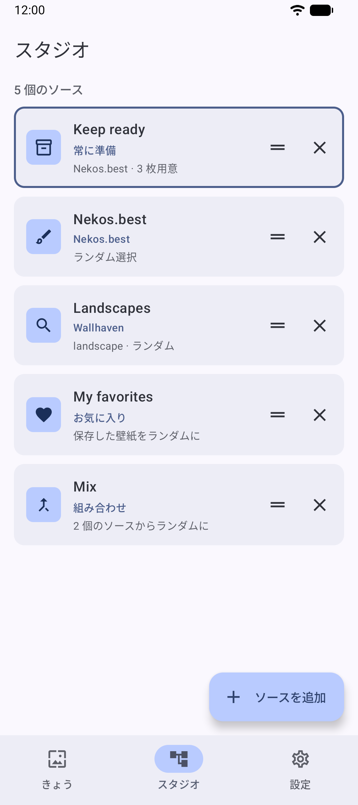

# Wallpaper Moe / ウォールペーパー萌え

[English](README.md) · **日本語** · [简体中文](README.zh-CN.md)

> 画面をつけるたびに、新しい壁紙が待っています ♡ (◕‿◕✿)

[](#インストール)
[](LICENSE)

Wallpaper Moe は自動で切り替わるライブ壁紙です。オンラインのコレクション、端末のフォルダ、またはお気に入りから壁紙を取得します。切り替えは画面が消灯したときに行われます。頻度は「消灯するたび」から「1 日に 1 回まで」の間で選べます。

| きょう | スタジオ | お気に入り |
| :---: | :---: | :---: |
|  |  |  |

## 機能

- **ホーム画面とロック画面。** 両方の画面で 1 つのソースを使うことも、画面ごとに別のソースと頻度を使うこともできます。明るさ、コントラスト、ぼかしは画面ごとに設定できます。ロックを解除すると、ロック画面の表示からホーム画面の表示へなめらかに変わります。
- **自分で組み立てるソース。** ソースは他のソースを使えます。一度設定したソースをいろいろな場所で使えます。
- **履歴とお気に入り。** 直近 20 枚の壁紙が元のサイズのまま端末に残ります。ハートをタップすると壁紙を残せます。お気に入りは並べ替えできます。
- **ビューア。** 履歴やお気に入りをスワイプとズームで見られます。画像を壁紙に設定、ギャラリーに保存、共有、出典ページを開くことができます。
- **「次の壁紙」タイル。** クイック設定にタイルを追加すると、どこからでも壁紙を変更できます。
- **壁紙の色。** 現在の壁紙の色を Android に伝えるので、システムのテーマが壁紙に合わせて変わります。
- **従量制でないネットワークのみ。** 自動変更は Wi‑Fi を待つことができます。
- **バックアップ。** ソース、設定、お気に入りを 1 つのファイルにエクスポートし、別の端末でインポートできます。

## ソース

| ソース | 内容 |
| --- | --- |
| **Wallhaven** | wallhaven.cc をキーワード、カテゴリ、健全度、アスペクト比、並び順で検索します。 |
| **Nekos.best** | 選んだ種類のアニメ作品を、ランダムまたは順番に取得します。 |
| **Pandora** | Xiaomi の公開壁紙チャンネルから画像を取得します。 |
| **端末のフォルダ** | 端末のフォルダとそのサブフォルダにある画像を使います。 |
| **お気に入り** | ハートを付けた壁紙を、ランダムまたは自分で決めた順番で使います。 |
| **常に準備** | 別のソースについて、変更の前に壁紙を用意する、あとで使うために保存する、またはその両方を行います。 |
| **組み合わせ** | 2 つ以上のソースを、ランダム、順番、または代替として使います。 |

## インストール

Wallpaper Moe には **Android 14 以降** が必要です。

[](https://f-droid.org/packages/dev.leeeet.wallpapermoe/)

[](https://apps.obtainium.imranr.dev/redirect?r=obtainium://app/%7B%22id%22%3A%22dev.leeeet.wallpapermoe%22%2C%22url%22%3A%22https%3A%2F%2Fgithub.com%2FLeeeeT%2FWallpaperMoe%22%2C%22author%22%3A%22LeeeeT%22%2C%22name%22%3A%22Wallpaper%20Moe%22%7D)

1. [GitHub Releases](../../releases) から最新の APK をダウンロードします。
2. インストールします。APK を開いたアプリからのインストールを許可するよう Android に求められることがあります。
3. **きょう** で **Wallpaper Moe を有効にする** をタップします。Android のプレビューで、ホーム画面とロック画面に壁紙を設定します。

## プライバシー

Wallpaper Moe には広告、分析、トラッキングがありません。すべてのデータは端末に残ります。Android のクラウドバックアップにも含まれません。

アプリが接続するのは、設定したソースのプロバイダーだけです。

- Wallhaven へのリクエストには検索条件が含まれます。API キーは NSFW 画像を含む検索のときだけ送信されます。
- Nekos.best へのリクエストには作品の種類が含まれます。
- Pandora へのリクエストには、アプリのバージョン、言語、画面の幅、時刻、このインストール用のランダムな識別子が含まれます。
- 端末のフォルダのソースは、選んだフォルダだけを読み取ります。

バックアップファイルには Wallhaven API キーは含まれません。

## 開発者向け

リポジトリには Nix の開発環境があります。

```bash
nix develop --command ./gradlew :app:installDebug
```

デバッグビルドのアプリケーション ID は `dev.leeeet.wallpapermoe.debug` なので、リリースビルドと並べてインストールできます。

ホストの GPU でエミュレータを起動するには:

```bash
nix run .#emulator
```

リリースの手順は [RELEASING.md](RELEASING.md) を参照してください。

## ライセンスとサービス

Wallpaper Moe は [MIT ライセンス](LICENSE) で提供されています。

Wallpaper Moe は wallhaven.cc、Nekos.best、Xiaomi とは関係がなく、これらの推奨も受けていません。壁紙の画像には作者とプロバイダーの規約が適用されます。

萌えが好きなすべての人へ、♡ を込めて。(ﾉ◕ヮ◕)ﾉ*:･ﾟ✧
