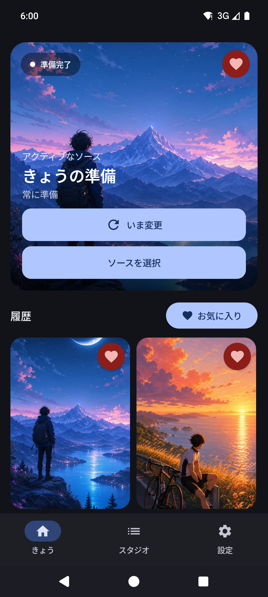
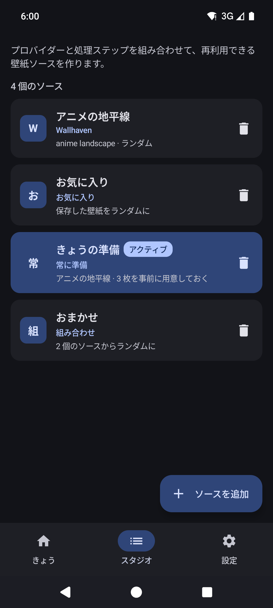
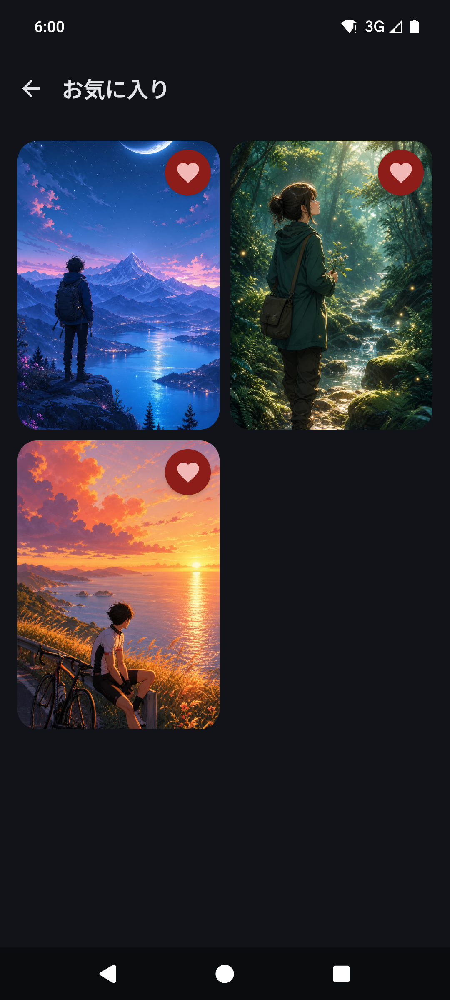

# Wallpaper Moe / ウォールペーパー萌え

[English](README.md) · **日本語** · [简体中文](README.zh-CN.md)

あなたと一緒に移り変わる、壁紙コレクション。

[](#インストール)
[](LICENSE)

Wallpaper Moe は壁紙を自動で切り替えます。オンラインのコレクションや自分のお気に入りからソースを組み立て、切り替えのペースを選べば、あとは画面が消えている間にアプリが処理します。

| きょう | スタジオ | お気に入り |
| :---: | :---: | :---: |
|  |  |  |

## Wallpaper Moe を選ぶ理由

- **落ち着いた日々のビュー。** 現在の壁紙を確認し、すぐに変更し、最新 20 枚を見返して、トリミング前の原寸画像を開けます。
- **お気に入りはあなたのもの。** 現在または過去の壁紙のハートをタップするだけ。お気に入りはアプリ内ストレージに複製されるので、履歴が整理されても残ります。
- **好みに合うソース。** Pandora のチャンネルを見る、Nekos.best の静止画カテゴリを探す、Wallhaven を検索する、すでにお気に入りに入れた壁紙を巡回する、どれでも選べます。
- **強力なのに面倒ではない。** 複数のソースをランダム・順番・フォールバックで組み合わせられます。素早い切り替えのために、壁紙をキャッシュしたり事前に用意したりもできます。
- **Android 標準の適用先選択。** ホーム画面・ロック画面・その両方から選べ、間隔はロックのたびから 1 日 1 回まで指定できます。
- **さまざまな画面に対応。** コンパクトなスマートフォンからタブレットまでレイアウトが適応します。

## ソース

**スタジオ** を開くと、名前を付けたソースを作成して再利用できます。

| ソース | 説明 |
| --- | --- |
| **常に準備** | 既存のソースにキャッシュ、先読み、またはその両方を追加します。 |
| **組み合わせ** | 既存の複数ソースをランダム・順番・フォールバックで使います。 |
| **お気に入り** | 端末内のお気に入りからランダムまたは順番に選びます。 |
| **Wallhaven** | wallhaven.cc をキーワード・カテゴリ・健全度・アスペクト比・並び順で検索します。 |
| **Nekos.best** | 現在の静止画カテゴリを検出し、選んだカテゴリからランダムまたは順番に取得します。 |
| **Pandora** | Xiaomi の公開壁紙チャンネルから選びます。 |

ソースは別のソースの中でも再利用できるので、プロバイダーの設定は一度で済みます。1 つのソースをアクティブに指定すると、自動変更と **いま変更** の両方で使われます。

## インストール

Wallpaper Moe には **Android 14 以降** と `arm64-v8a` または `x86_64` の端末が必要です。

[](https://apps.obtainium.page/redirect?r=obtainium%3A%2F%2Fapp%2F%257B%2522id%2522%253A%2522dev.leeeet.wallpapermoe%2522%252C%2522url%2522%253A%2522https%253A%252F%252Fgithub.com%252FLeeeeT%252FWallpaperMoe%2522%252C%2522author%2522%253A%2522LeeeeT%2522%252C%2522name%2522%253A%2522Wallpaper%2520Moe%2522%257D)

1. [GitHub Releases](../../releases) から最新の APK をダウンロードします。
2. インストールします。APK を開いたアプリからのインストール許可を Android が求めることがあります。
3. **スタジオ** を開いてソースを追加し、アクティブに設定します。
4. **きょう** で **Wallpaper Moe を有効にする** をタップし、Android の壁紙プレビューでホーム画面・ロック画面・その両方から選びます。
5. **設定** で切り替え間隔を選びます。

壁紙の変更は通常、画面が消灯している間に適用されるため、操作を妨げません。すぐ更新したいときはいつでも **いま変更** が使えます。

## プライバシー

Wallpaper Moe にはアカウント・広告・アナリティクス・トラッキング SDK がありません。ソース設定、履歴、キャッシュした画像、お気に入り、Wallhaven の API キーは、すべてアプリ専用の端末内ストレージにのみ保存されます。Android のバックアップは無効化されています。

アプリが通信するのは、あなたが設定したプロバイダーだけです。

- Pandora へのリクエストには、アプリのバージョン、ロケール、画面幅、現在時刻、そのインストールごとに生成されるランダムな識別子が含まれます。
- Wallhaven へのリクエストには、選択したフィルターと、入力した場合は API キーが含まれます。
- Nekos.best へのリクエストには、選択したカテゴリ名と、必須の User-Agent に含めるプロジェクト URL が含まれます。画像取得はプロセス共通のキューを使い、カテゴリごとに 1 分あたり 200 リクエストという API 制限に合わせて間隔を空けます。API が返す作者・出典情報は壁紙とともに保持され、プレビューに表示されます。

Wallpaper Moe はサーバーを運用しておらず、これらのデータを受け取ることもありません。

## 権限

- **インターネット** はソース一覧と壁紙のダウンロードに使います。通知・起動時実行・電池使用量の制限解除は必要ありません。

## コントリビューター向け

このリポジトリには、JDK・Gradle・Android SDK・エミュレーター・ADB を含む、バージョン固定の Nix 開発環境が含まれています。

```bash
nix develop
gradle :app:assembleDebug
```

環境を通してコマンドを直接実行することもできます。

```bash
nix develop --command gradle :app:lintDebug
nix develop --command gradle :app:connectedDebugAndroidTest
```

インストルメンテーションテストは、ローカルのモックサーバーを使ったプロバイダー、ソースの合成と永続化、画像ストレージ、下書きの検証、履歴、お気に入りを対象としています。主要なコードは `app/src/main/kotlin/dev/leeeet/wallpapermoe/` 以下に、ソース・プロバイダー・ネットワーク・壁紙・サービス・データ・UI の関心事ごとに整理されています。

## ライセンスとサービス

Wallpaper Moe は [MIT ライセンス](LICENSE) で提供されています。

本プロジェクトは Xiaomi、wallhaven.cc、Nekos.best とは提携・承認・関連のいずれもありません。壁紙画像は、その制作者および提供元の規約に従います。Nekos.best のコンテンツは非商用利用に限られます。Wallpaper Moe はカテゴリごとの API レート制限を守り、作者情報を保持します。
