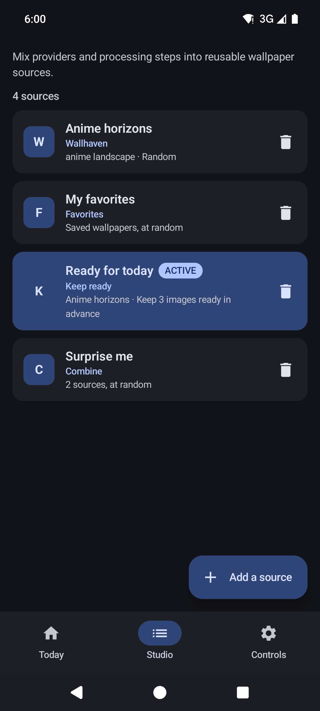

# Wallpaper Moe / ウォールペーパー萌え

[English](README.md) · **日本語** · [简体中文](README.zh-CN.md)

あなたと一緒に移り変わる、壁紙コレクション。

[](#インストール)
[](LICENSE)

Wallpaper Moe はロック画面・ホーム画面、またはその両方の壁紙を自動で切り替えます。オンラインのコレクションや自分のお気に入りからソースを組み立て、切り替えのペースを選べば、あとは画面が消えている間にアプリが処理します。

| きょう | スタジオ | お気に入り |
| :---: | :---: | :---: |
|  |  |  |

## Wallpaper Moe を選ぶ理由

- **落ち着いた日々のビュー。** 現在の壁紙を確認し、すぐに変更し、最新 20 枚を見返して、トリミング前の原寸画像を開けます。
- **お気に入りはあなたのもの。** 現在または過去の壁紙のハートをタップするだけ。お気に入りはアプリ内ストレージに複製されるので、履歴が整理されても残ります。
- **好みに合うソース。** Pandora のチャンネルを見る、Wallhaven を検索する、すでにお気に入りに入れた壁紙を巡回する、どれでも選べます。
- **強力なのに面倒ではない。** 複数のソースをランダム・順番・フォールバックで組み合わせられます。素早い切り替えのために、壁紙をキャッシュしたり事前に用意したりもできます。
- **独立した設定。** ロック画面・ホーム画面・その両方を選べ、間隔はロックのたびから 1 日 1 回まで指定できます。
- **さまざまな画面に対応。** コンパクトなスマートフォンからタブレットまでレイアウトが適応します。

## ソース

**スタジオ** を開くと、名前を付けたソースを作成して再利用できます。

| ソース | 説明 |
| --- | --- |
| **Pandora** | Xiaomi の公開壁紙チャンネルから選びます。 |
| **Wallhaven** | wallhaven.cc をキーワード・カテゴリ・健全度・並び順で検索します。 |
| **お気に入り** | 端末内のお気に入りからランダムまたは順番に選びます。 |
| **組み合わせ** | 既存の複数ソースをランダム・順番・フォールバックで使います。 |
| **常に準備** | 既存のソースにキャッシュと先読みを追加します。 |

ソースは別のソースの中でも再利用できるので、プロバイダーの設定は一度で済みます。1 つのソースをアクティブに指定すると、自動変更と **いま変更** の両方で使われます。

## インストール

Wallpaper Moe には **Android 14 以降** と `arm64-v8a` または `x86_64` の端末が必要です。

1. [GitHub Releases](../../releases) から最新の APK をダウンロードします。
2. インストールします。APK を開いたアプリからのインストール許可を Android が求めることがあります。
3. Wallpaper Moe を開き、2 つのセットアップ項目（通知の許可と電池使用量の制限解除）を完了します。
4. **スタジオ** を開いてソースを追加し、アクティブに設定します。
5. **設定** で適用先と切り替え間隔を選びます。

壁紙の変更は通常、画面が消灯している間に適用されるため、操作を妨げません。すぐ更新したいときはいつでも **いま変更** が使えます。

## プライバシー

Wallpaper Moe にはアカウント・広告・アナリティクス・トラッキング SDK がありません。ソース設定、履歴、キャッシュした画像、お気に入り、Wallhaven の API キーは、すべてアプリ専用の端末内ストレージにのみ保存されます。Android のバックアップは無効化されています。

アプリが通信するのは、あなたが設定したプロバイダーだけです。

- Pandora へのリクエストには、アプリのバージョン、ロケール、画面幅、現在時刻、そのインストールごとに生成されるランダムな識別子が含まれます。
- Wallhaven へのリクエストには、選択したフィルターと、入力した場合は API キーが含まれます。

Wallpaper Moe はサーバーを運用しておらず、これらのデータを受け取ることもありません。

## 権限

- **インターネット** はソース一覧・壁紙・原寸プレビューのダウンロードに使います。
- **壁紙の設定** は選択したロック画面とホーム画面の画像を変更します。
- **通知とフォアグラウンドサービス** はバックグラウンドでの切り替えを維持します。ステータス通知は音を鳴らしません。
- **起動時に実行** は再起動後に切り替えを復帰させます。
- **電池使用量の制限解除** は Android がバックグラウンドの切り替えを止めるのを防ぎます。

## 開発者向け

このリポジトリには、JDK・Gradle・Android SDK・エミュレーター・ADB を含む、バージョン固定の Nix 開発環境が含まれています。

```bash
nix develop
gradle :app:assembleDebug
```

環境を通してコマンドを直接実行することもできます。

```bash
nix develop --command gradle :app:lintDebug
nix develop --command gradle :app:connectedDebugAndroidTest
```

インストルメンテーションテストは、ローカルのモックサーバーを使ったプロバイダー、ソースの合成と永続化、画像ストレージ、下書きの検証、履歴、お気に入りを対象としています。主要なコードは `app/src/main/kotlin/dev/leeeet/wallpapermoe/` 以下に、ソース・プロバイダー・画像・壁紙・サービス・データ・UI の関心事ごとに整理されています。

### リリースの作り方

リリースは、エミュレーターとシステムイメージを除いた小さめの Nix 環境でローカルに用意します。Android ツールチェーンは Nix ストアに保持され、Gradle は依存関係とビルドのキャッシュをリリース間で再利用します。

Gradle のユーザープロパティファイルに、本番用のキーストアを設定します。

```properties
moe.storeFile=/absolute/path/to/wallpaper-moe.jks
moe.storePassword=...
moe.keyAlias=...
moe.keyPassword=...
```

リリースビルドが Android のデバッグ鍵にフォールバックすることはありません。ローカルのリリースコマンドは APK の証明書も検証し、Android のデバッグ証明書を拒否します。

`gh auth login` で GitHub CLI を認証し、`origin` を設定したうえで、`origin/main` と完全に一致するクリーンな `main` から始めます。そのうえで、安定版セマンティックバージョンの上げ方を選びます。

```bash
nix run .#release -- patch
# または: minor / major
```

このコマンドは次のことを行います。

1. `version.properties` の `versionName` と単調増加する Android の `versionCode` を更新します。
2. リリース lint を実行し、本番署名済みのユニバーサル APK をビルドします。
3. 署名付きの `Release vX.Y.Z` コミットと署名付き注釈タグを作成します。
4. `main` とタグをアトミックにプッシュします。
5. `wallpaper-moe-vX.Y.Z.apk` と SHA-256 チェックサムを、自動生成されたリリースノート付きの下書きリリースにアップロードします。

バージョン・lint・APK ビルド・署名証明書・コミット・タグのすべてがローカルで通るまで、何もプッシュされません。アトミックなプッシュのあとに GitHub リリースの作成やアセットのアップロードが中断された場合は、同じコマンドをもう一度実行すれば、バージョンを上げ直すことなく同じ成果物を再ビルドしてその下書きを仕上げます。

## ライセンスとサービス

Wallpaper Moe は [MIT ライセンス](LICENSE) で提供されています。

本プロジェクトは Xiaomi および wallhaven.cc とは提携・承認・関連のいずれもありません。壁紙画像は、その制作者および提供元の規約に従います。
