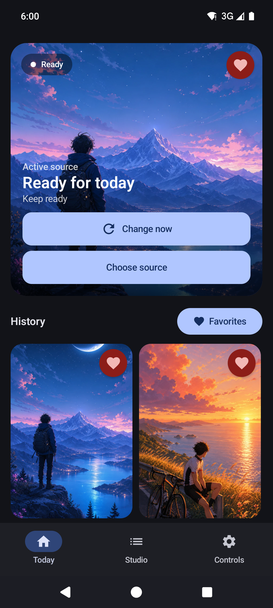

# Wallpaper Moe / ウォールペーパー萌え

**English** · [日本語](README.ja.md) · [简体中文](README.zh-CN.md)

> A new wallpaper waits for you each time the screen turns on ♡ (◕‿◕✿)

[](#install)
[](LICENSE)

Wallpaper Moe is a live wallpaper that changes itself. It gets wallpapers from online collections, from a folder on your device, or from your favorites. A change occurs when the screen goes off: each time, or at most each hour, each 6 hours or each day.

| Today | Studio | Favorites |
| :---: | :---: | :---: |
|  |  |  |

## Features

- **Home and lock screen.** Both screens can use one source, or each screen can have its own source and frequency. Each screen has its own brightness, contrast and blur. At unlock, the wallpaper changes smoothly from the lock look to the home look.
- **Sources that you build.** A source can use other sources. You configure a source one time and use it in many places.
- **History and favorites.** The last 20 wallpapers stay on the device at full size. Tap a heart to keep a wallpaper. You can put favorites in order.
- **Viewer.** Swipe and zoom through the history or the favorites. Set an image as the wallpaper, save it to the gallery, share it, or open its source page.
- **Next wallpaper tile.** Add the tile to Quick Settings to change the wallpaper from anywhere.
- **Wallpaper colors.** The app gives the colors of the current wallpaper to Android, so the system theme can follow the wallpaper.
- **Unmetered networks only.** Automatic changes can wait for Wi‑Fi.
- **Backup.** Export the sources, settings and favorites to one file, and import them on a different device.

## Sources

| Source | What it does |
| --- | --- |
| **Wallhaven** | Searches wallhaven.cc by text, category, purity, aspect ratio and order. |
| **Nekos.best** | Gets anime artwork from the kinds that you select, at random or in turn. |
| **Pandora** | Gets images from Xiaomi's public wallpaper channels. |
| **Device folder** | Uses the images in a folder on your device and in its subfolders. |
| **Favorites** | Uses the wallpapers that you marked with a heart, at random or in your order. |
| **Keep ready** | Prepares wallpapers before a change, saves wallpapers for later, or both, for a different source. |
| **Combine** | Uses two or more sources at random, in turn, or as fallbacks. |

## Install

Wallpaper Moe requires **Android 14 or newer**.

[](https://f-droid.org/packages/dev.leeeet.wallpapermoe/)

[](https://apps.obtainium.imranr.dev/redirect?r=obtainium://app/%7B%22id%22%3A%22dev.leeeet.wallpapermoe%22%2C%22url%22%3A%22https%3A%2F%2Fgithub.com%2FLeeeeT%2FWallpaperMoe%22%2C%22author%22%3A%22LeeeeT%22%2C%22name%22%3A%22Wallpaper%20Moe%22%7D)

1. Download the latest APK from [GitHub Releases](../../releases).
2. Install it. Android can ask you to allow installs from the app that opened the APK.
3. On **Today**, tap **Activate Wallpaper Moe**. In the Android preview, apply the wallpaper to the home screen and the lock screen.

## Privacy

Wallpaper Moe has no ads, no analytics and no tracking. All data stays on the device. Android cloud backup does not include it.

The app connects only to the providers of the sources that you configure:

- Wallhaven requests contain your filters. The app sends your API key only for searches that include NSFW images.
- Nekos.best requests contain the kind of artwork.
- Pandora requests contain the app version, the language, the screen width, the time and a random identifier for this installation.
- The device folder source reads only the folder that you choose.

The backup file does not contain the Wallhaven API key.

## For contributors

The repository has a Nix development environment:

```bash
nix develop --command ./gradlew :app:installDebug
```

The debug build has the application ID `dev.leeeet.wallpapermoe.debug`, so it installs next to the release build.

To start an emulator with the host GPU:

```bash
nix run .#emulator
```

To make a release, read [RELEASING.md](RELEASING.md).

## License and services

Wallpaper Moe is available under the [MIT license](LICENSE).

Wallpaper Moe has no connection with wallhaven.cc, Nekos.best or Xiaomi, and they do not endorse it. The terms of the creators and providers apply to the wallpaper images.

Made with ♡ for everyone who loves moe. (ﾉ◕ヮ◕)ﾉ*:･ﾟ✧
