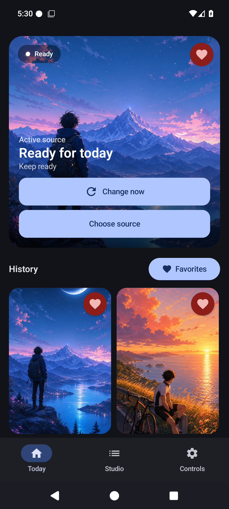

# Wallpaper Moe / ウォールペーパー萌え

**English** · [日本語](README.ja.md) · [简体中文](README.zh-CN.md)

Your wallpaper collection, changing with you.

[](#install)
[](LICENSE)

Wallpaper Moe automatically refreshes your lock screen, home screen, or both. Build a source from online collections or your own favorites, choose a rhythm, and let the app handle the rest while the screen is off.

| Today | Studio | Favorites |
| :---: | :---: | :---: |
|  |  |  |

## Why Wallpaper Moe?

- **A calm daily view.** See the current wallpaper, change it immediately, browse the latest 20 wallpapers, and open their uncropped originals.
- **Favorites stay yours.** Tap the heart on any current or previous wallpaper. Favorites are copied to app storage and remain available even if history is pruned.
- **Sources fit your taste.** Browse Pandora channels, search Wallhaven, or rotate through wallpapers you have already favorited.
- **Powerful without being fiddly.** Combine multiple sources randomly, in order, or as fallbacks. Keep wallpapers cached or prepared ahead of time for quick changes.
- **Independent controls.** Choose the lock screen, home screen, or both, with intervals from every lock to once per day.
- **Made for different screens.** The layout adapts from compact phones to tablets.

## Sources

Open **Studio** to create and reuse named sources:

| Source | What it does |
| --- | --- |
| **Keep ready** | Adds optional caching and prefetching to an existing source. |
| **Combine** | Uses several existing sources randomly, in order, or as fallbacks. |
| **Favorites** | Samples your on-device favorites randomly or in round-robin order. |
| **Wallhaven** | Searches wallhaven.cc by query, category, purity, and order. |
| **Pandora** | Samples from Xiaomi's public wallpaper channels. |

Sources can be reused inside other sources, so a provider only needs to be configured once. Select one source as active; it will be used for both automatic changes and **Change now**.

## Install

Wallpaper Moe requires **Android 14 or newer** on an `arm64-v8a` or `x86_64` device.

1. Download the latest APK from [GitHub Releases](../../releases).
2. Install it. Android may ask you to allow installs from the app that opened the APK.
3. Open Wallpaper Moe and complete the two setup prompts: allow notifications and unrestricted battery use.
4. Open **Studio**, add a source, and mark it active.
5. Use **Controls** to choose the destination and rotation interval.

Wallpaper changes are normally applied while the screen is off, so they do not interrupt you. **Change now** is available whenever you want an immediate refresh.

## Privacy

Wallpaper Moe has no accounts, ads, analytics, or tracking SDKs. Source settings, history, cached images, favorites, and any Wallhaven API key are stored only in the app's private on-device storage. Android backup is disabled for the app.

The app contacts only the provider sources you configure:

- Pandora requests include the app version, locale, screen width, current time, and a random identifier created for that app installation.
- Wallhaven requests include your selected filters and, when supplied, your API key.

Wallpaper Moe does not operate a server and does not receive this data.

## Permissions

- **Internet** downloads source lists, wallpapers, and original previews.
- **Set wallpaper** changes the lock and home screen images you select.
- **Notifications and foreground service** keep rotation available in the background. The status notification is silent.
- **Run at startup** restores rotation after the device reboots.
- **Unrestricted battery use** prevents Android from stopping background rotation.

## For contributors

The repository includes a pinned Nix development environment with the JDK, Gradle, Android SDK, emulator, and ADB:

```bash
nix develop
gradle :app:assembleDebug
```

Or run commands directly through the environment:

```bash
nix develop --command gradle :app:lintDebug
nix develop --command gradle :app:connectedDebugAndroidTest
```

Instrumentation tests cover providers with a local mock server, source composition and persistence, image storage, draft validation, history, and favorites. The main code is organized under `app/src/main/kotlin/dev/leeeet/wallpapermoe/` by source, provider, image, wallpaper, service, data, and UI concerns.

## License and services

Wallpaper Moe is available under the [MIT license](LICENSE).

The project is not affiliated with, endorsed by, or connected to Xiaomi or wallhaven.cc. Wallpaper images remain subject to their creators' and providers' terms.
