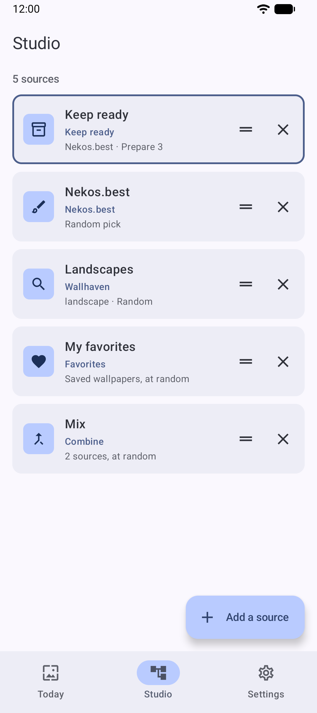
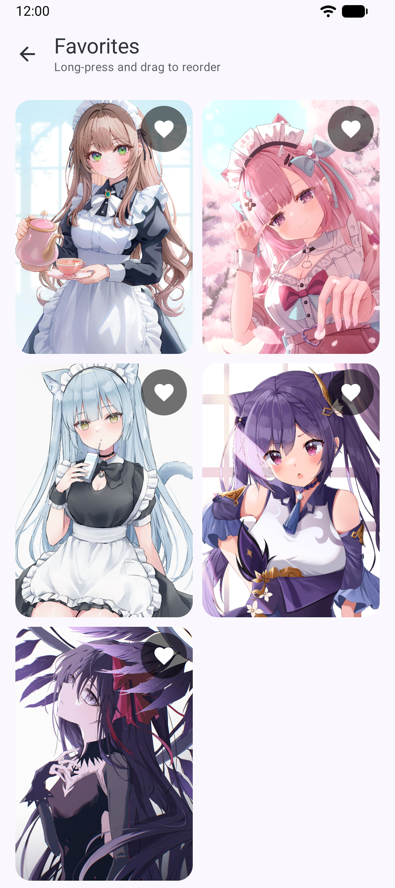

# Wallpaper Moe / ウォールペーパー萌え

**English** · [日本語](README.ja.md) · [简体中文](README.zh-CN.md)

[](#install)
[](LICENSE)

Wallpaper Moe changes your Android wallpaper automatically, drawing from online collections or from your own favorites. It runs as a live wallpaper. Changes happen when the screen locks, as often as every lock or as rarely as once a day.

| Today | Studio | Favorites |
| :---: | :---: | :---: |
|  |  |  |

## Sources

Open **Studio** to create sources:

| Source | What it does |
| --- | --- |
| **Keep ready** | Adds caching, prefetching, or both to an existing source. |
| **Combine** | Uses several existing sources randomly, in order, or as fallbacks. |
| **Favorites** | Samples the wallpapers you hearted, randomly or in round-robin order. |
| **Wallhaven** | Searches wallhaven.cc by query, category, purity, aspect ratio, and order. |
| **Nekos.best** | Samples selected categories randomly or in round-robin order. |
| **Pandora** | Samples from Xiaomi's public wallpaper channels. |

Sources can be reused inside other sources, so a source only needs to be configured once. One source is marked active, and it is the one every change draws from.

## Install

Wallpaper Moe requires **Android 14 or newer** on an `arm64-v8a` or `x86_64` device.

[](https://apps.obtainium.page/redirect?r=obtainium%3A%2F%2Fapp%2F%257B%2522id%2522%253A%2522dev.leeeet.wallpapermoe%2522%252C%2522url%2522%253A%2522https%253A%252F%252Fgithub.com%252FLeeeeT%252FWallpaperMoe%2522%252C%2522author%2522%253A%2522LeeeeT%2522%252C%2522name%2522%253A%2522Wallpaper%2520Moe%2522%257D)

1. Download the latest APK from [GitHub Releases](../../releases).
2. Install it. Android may ask you to allow installs from the app that opened the APK.
3. Open **Studio**, add a source, and mark it active.
4. On **Today**, tap **Activate Wallpaper Moe**, then use Android’s wallpaper preview to choose the home screen, lock screen, or both.

## Privacy

Wallpaper Moe has no ads, analytics, or tracking SDKs. All data is stored on-device.

The app contacts only the provider sources you configure:

- Pandora requests include the app version, locale, screen width, current time, and a random identifier created for that app installation.
- Wallhaven requests include your selected filters and, when supplied, your API key.

## For contributors

The repository includes a Nix development environment:

```bash
nix develop
gradle :app:assembleDebug
```

Or run commands directly through the environment:

```bash
nix develop --command gradle :app:lintDebug
nix develop --command gradle :app:connectedDebugAndroidTest
```

The main code is organized under `app/src/main/kotlin/dev/leeeet/wallpapermoe/`.

## License and services

Wallpaper Moe is available under the [MIT license](LICENSE).

The project is not affiliated with, endorsed by, or connected to wallhaven.cc, Nekos.best, or Xiaomi. Wallpaper images remain subject to their creators' and providers' terms.
