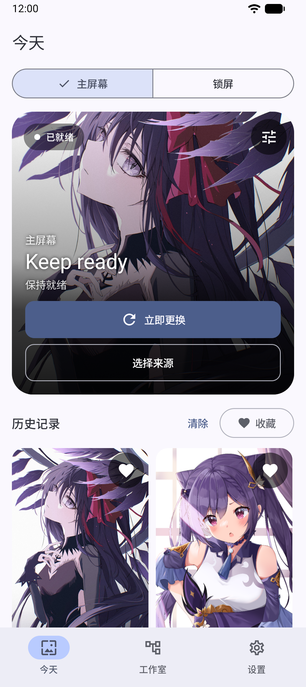
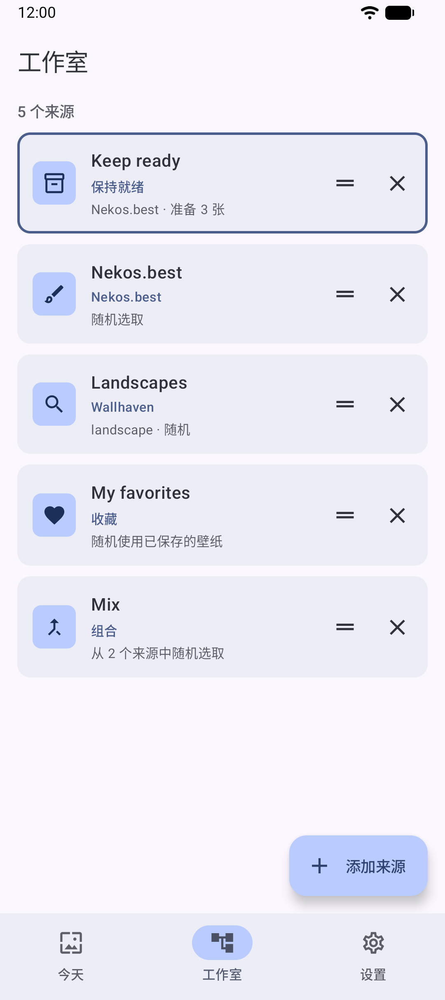

# Wallpaper Moe / ウォールペーパー萌え

[English](README.md) · [日本語](README.ja.md) · **简体中文**

> 每次点亮屏幕，都有一张新壁纸在等你 ♡ (◕‿◕✿)

[](#安装)
[](LICENSE)

Wallpaper Moe 是一款会自动更换的动态壁纸。它从在线图库、本机文件夹或你的收藏中获取壁纸。更换在息屏时进行，频率可以是每次息屏，也可以是最多每小时、每 6 小时或每天一次。

| 今天 | 工作室 | 收藏 |
| :---: | :---: | :---: |
|  |  |  |

## 功能

- **主屏幕和锁屏。** 两个屏幕可以共用一个来源，也可以各自使用自己的来源和频率。每个屏幕都有自己的亮度、对比度和模糊设置。解锁时，壁纸会从锁屏外观平滑过渡到主屏幕外观。
- **自己搭建来源。** 来源可以使用其他来源。一个来源只需配置一次，就能在多处使用。
- **历史记录和收藏。** 最近 20 张壁纸会以原尺寸保留在本机。点按爱心即可保留壁纸。收藏可以排序。
- **查看器。** 在历史记录或收藏中滑动和缩放浏览。可以把图片设为壁纸、保存到相册、分享或打开出处页面。
- **“下一张壁纸”图块。** 把图块添加到快捷设置，即可随时更换壁纸。
- **壁纸颜色。** 应用会把当前壁纸的颜色提供给 Android，系统主题可以随壁纸变化。
- **仅限不按流量计费的网络。** 自动更换可以等待 Wi‑Fi。
- **备份。** 把来源、设置和收藏导出到一个文件，并在其他设备上导入。

## 来源

| 来源 | 作用 |
| --- | --- |
| **Wallhaven** | 按关键词、分类、尺度、宽高比和排序搜索 wallhaven.cc。 |
| **Nekos.best** | 从你选择的类型中随机或轮流获取动漫作品。 |
| **Pandora** | 从小米的公开壁纸频道获取图片。 |
| **设备文件夹** | 使用本机某个文件夹及其子文件夹中的图片。 |
| **收藏** | 随机或按你的顺序使用你点过爱心的壁纸。 |
| **保持就绪** | 为另一个来源在更换前准备壁纸、保存壁纸以便稍后使用，或两者兼有。 |
| **组合** | 随机、轮流或依次回退地使用两个或更多来源。 |

## 安装

Wallpaper Moe 需要 **Android 14 或更高版本**。

[](https://f-droid.org/packages/dev.leeeet.wallpapermoe/)

[](https://apps.obtainium.imranr.dev/redirect?r=obtainium://app/%7B%22id%22%3A%22dev.leeeet.wallpapermoe%22%2C%22url%22%3A%22https%3A%2F%2Fgithub.com%2FLeeeeT%2FWallpaperMoe%22%2C%22author%22%3A%22LeeeeT%22%2C%22name%22%3A%22Wallpaper%20Moe%22%7D)

1. 从 [GitHub Releases](../../releases) 下载最新的 APK。
2. 安装。Android 可能会要求你允许打开 APK 的应用安装应用。
3. 在 **今天** 中点按 **启用 Wallpaper Moe**。在 Android 的预览中，把壁纸应用到主屏幕和锁屏。

## 隐私

Wallpaper Moe 没有广告、分析或跟踪。所有数据都保留在本机，也不会包含在 Android 云备份中。

应用只连接你所配置来源的提供方：

- 发往 Wallhaven 的请求包含你的筛选条件。只有在搜索包含 NSFW 图片时才会发送你的 API 密钥。
- 发往 Nekos.best 的请求包含作品类型。
- 发往 Pandora 的请求包含应用版本、语言、屏幕宽度、时间，以及为此次安装生成的随机标识符。
- 设备文件夹来源只读取你选择的文件夹。

备份文件不包含 Wallhaven API 密钥。

## 参与开发

仓库提供 Nix 开发环境：

```bash
nix develop --command ./gradlew :app:installDebug
```

调试版本的应用 ID 是 `dev.leeeet.wallpapermoe.debug`，因此可以与正式版本同时安装。

使用主机 GPU 启动模拟器：

```bash
nix run .#emulator
```

发布步骤请阅读 [RELEASING.md](RELEASING.md)。

## 许可证与服务

Wallpaper Moe 基于 [MIT 许可证](LICENSE) 提供。

Wallpaper Moe 与 wallhaven.cc、Nekos.best 和小米没有关联，也未获得其认可。壁纸图片受其作者和提供方条款的约束。

献给所有喜欢萌的人，用 ♡ 制作。(ﾉ◕ヮ◕)ﾉ*:･ﾟ✧
