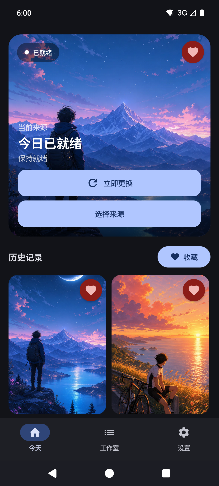
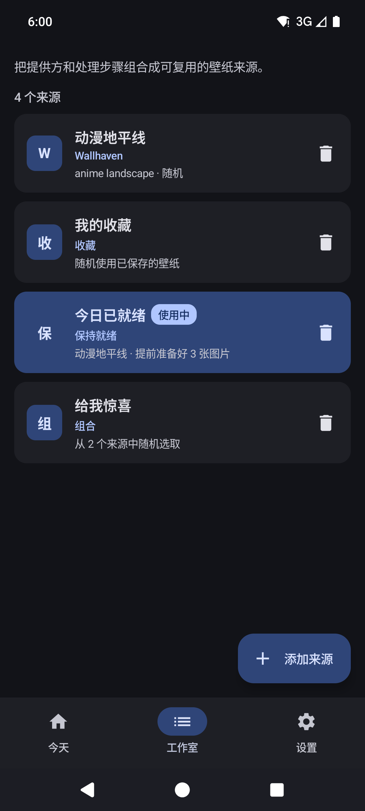

# Wallpaper Moe / ウォールペーパー萌え

[English](README.md) · [日本語](README.ja.md) · **简体中文**

你的壁纸收藏，随你而变。

[](#安装)
[](LICENSE)

Wallpaper Moe 会自动更换你的壁纸。用在线图库或自己的收藏搭建一个来源，选好节奏，剩下的交给应用在息屏时完成。

| 今天 | 工作室 | 收藏 |
| :---: | :---: | :---: |
|  |  |  |

## 为什么选择 Wallpaper Moe？

- **平静的日常视图。** 查看当前壁纸、立即更换、回顾最近 20 张，并打开未裁剪的原图。
- **收藏始终属于你。** 点按当前或历史壁纸上的爱心即可。收藏会复制到应用存储中，即使历史记录被清理也依然保留。
- **来源合你口味。** 浏览 Pandora 频道、发现 Nekos.best 静态图片分类、搜索 Wallhaven，或在已收藏的壁纸中轮换。
- **强大而不繁琐。** 可以随机、按顺序或作为备选来组合多个来源；也可以缓存壁纸或提前准备，让更换更迅速。
- **使用 Android 原生选择。** 可选择主屏幕、锁定屏幕或两者，间隔从每次锁屏到每天一次。
- **适配不同屏幕。** 布局可从小尺寸手机一直适应到平板。

## 来源

打开 **工作室** 即可创建并复用具名来源：

| 来源 | 作用 |
| --- | --- |
| **保持就绪** | 为已有来源添加可选缓存和预取。 |
| **组合** | 随机、按顺序或作为备选来使用多个已有来源。 |
| **收藏** | 从本机收藏中随机或轮流挑选。 |
| **Wallhaven** | 按关键词、分类、尺度、宽高比和排序搜索 wallhaven.cc。 |
| **Nekos.best** | 动态发现当前静态图片分类，并从所选分类中随机或轮流挑选。 |
| **Pandora** | 从小米的公开壁纸频道中挑选。 |

来源可以嵌套复用，因此每个提供方只需配置一次。将其中一个来源设为使用中，自动更换和 **立即更换** 都会使用它。

## 安装

Wallpaper Moe 需要 **Android 14 或更高版本**，且设备为 `arm64-v8a` 或 `x86_64` 架构。

1. 从 [GitHub Releases](../../releases) 下载最新的 APK。
2. 安装。Android 可能会要求你允许来自打开该 APK 的应用的安装权限。
3. 打开 **工作室**，添加一个来源并设为使用中。
4. 在 **今天** 点按 **启用 Wallpaper Moe**，然后在 Android 的壁纸预览中选择主屏幕、锁定屏幕或两者。
5. 在 **设置** 中选择更换间隔。

壁纸更换通常在息屏时进行，因此不会打断你。想立刻换一张时，随时可以使用 **立即更换**。

## 隐私

Wallpaper Moe 没有账号、广告、数据分析或跟踪 SDK。来源设置、历史记录、缓存图片、收藏以及 Wallhaven API 密钥，都只保存在应用私有的本机存储中。应用已禁用 Android 备份。

应用只会连接你自己配置的提供方：

- 发往 Pandora 的请求包含应用版本、语言区域、屏幕宽度、当前时间，以及为该次安装生成的随机标识符。
- 发往 Wallhaven 的请求包含你选择的筛选条件，以及在你填写时的 API 密钥。
- 发往 Nekos.best 的请求包含所选分类名称，以及其规定的 User-Agent 中的项目网址。图片获取使用进程级共享队列，并按照每分类每分钟 200 个请求的 API 限制控制间隔。API 提供的作者和原始来源署名会随壁纸保存，并显示在预览中。

Wallpaper Moe 不运营任何服务器，也不会收到这些数据。

## 权限

- **网络** 用于下载来源列表和壁纸。不需要通知、开机启动或不受限制的电池用量权限。

## 面向贡献者

仓库中包含一个版本固定的 Nix 开发环境，内含 JDK、Gradle、Android SDK、模拟器和 ADB：

```bash
nix develop
gradle :app:assembleDebug
```

也可以直接通过该环境运行命令：

```bash
nix develop --command gradle :app:lintDebug
nix develop --command gradle :app:connectedDebugAndroidTest
```

插桩测试覆盖了使用本地模拟服务器的提供方、来源的组合与持久化、图片存储、草稿校验、历史记录和收藏。主要代码位于 `app/src/main/kotlin/dev/leeeet/wallpapermoe/`，按来源、提供方、图片、壁纸、服务、数据和 UI 等关注点组织。

## 许可与服务

Wallpaper Moe 基于 [MIT 许可证](LICENSE) 提供。

本项目与小米、wallhaven.cc 及 Nekos.best 没有任何从属、认可或关联关系。壁纸图片仍受其创作者和提供方的条款约束。Nekos.best 内容仅限非商业用途；Wallpaper Moe 会遵守其每分类 API 速率限制，并保留署名信息。
